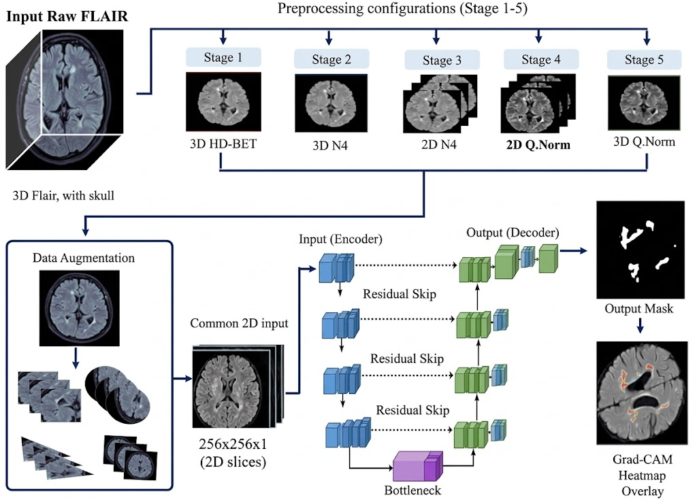
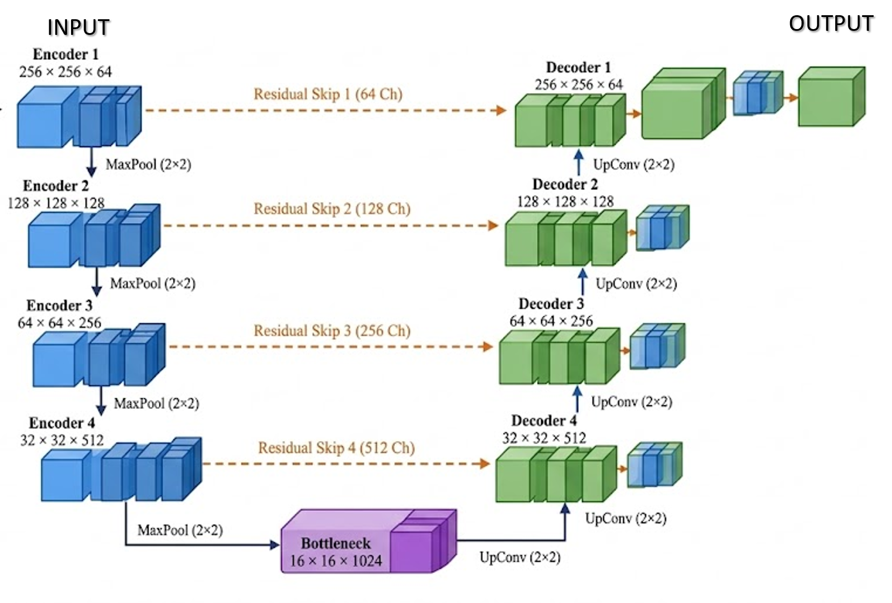
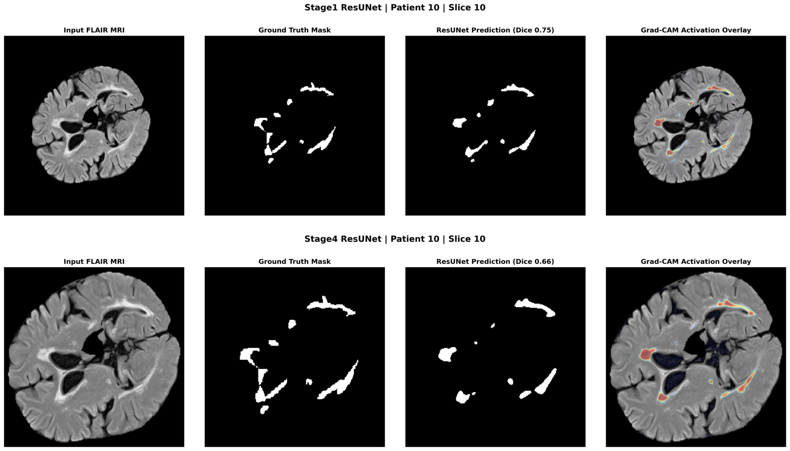

# Impact of Multi-Stage Preprocessing on 2D ResUNet-Based Explainable MS Lesion Segmentation in FLAIR Brain MRI

Undergraduate thesis project, Department of Computer Science, Islamia College University Peshawar, Pakistan (Session 2022-26).
Supervisor: Dr. Muhammad Sajjad. Research carried out at the Digital Image Processing (DIP) Lab.

**Keywords:** Multiple Sclerosis, Brain MRI segmentation, ResUNet, quantile normalization, N4 bias-field correction, patient-level splitting, Grad-CAM, deep learning, PyTorch

---

## In Plain Words

Multiple Sclerosis (MS) damages the brain and shows up as bright spots called *lesions* on FLAIR MRI scans. Doctors track these lesions to follow the disease, but outlining them by hand is slow. Deep learning can outline them automatically, but results depend heavily on **how the scans are cleaned up before training**.

This project asks one question: **how much does the choice of preprocessing change the results of the same segmentation network?**
To answer it, I trained the same 2D Residual U-Net (ResUNet) on **five different preprocessing configurations** of the same 60-patient dataset and compared them, using a **patient-level** data split so that slices of one patient never appear in both training and evaluation.

## Key Results

All numbers below are on the **validation cohort (6 patients, 146 slices)**.

| Preprocessing | Dice | IoU | Precision | Recall | Loss |
|---|---|---|---|---|---|
| Stage 1 | 0.6244 | 0.4603 | 0.6408 | 0.6325 | 0.3888 |
| Stage 2 | 0.6095 | 0.4406 | 0.6627 | 0.5833 | 0.3982 |
| Stage 3 | 0.3381 | 0.2289 | 0.5374 | 0.3485 | 0.6619 |
| **Stage 4 (best)** | **0.6255** | **0.4623** | **0.6788** | 0.6051 | **0.3757** |
| Stage 5 | 0.6020 | 0.4355 | 0.6314 | 0.5972 | 0.4000 |

**What this shows**
- **Stage 4 scored highest** (Dice 0.6255), but only by a small margin: Stage 1 reached 0.6244, and Stages 2 and 5 are within about 0.024. With one training run per configuration, these small differences should not be over-interpreted.
- **Stage 3 was clearly the weakest** (Dice 0.3381). Cropping without quantile normalization generalized poorly, while cropping *with* quantile normalization (Stage 4) gave the best result. The effect of a preprocessing step therefore depends on the steps it is combined with.
- **Precision was higher than recall in every configuration**, so the models tend to under-segment (missing small lesions is the main error).
- **ResUNet vs. vanilla U-Net** (same Stage 5 preprocessing): Dice **0.6020 vs. 0.5421**.

A Dice around 0.6 is moderate. It is in line with how difficult MS lesion segmentation is, and **no state-of-the-art claim is made**.

## The Five Preprocessing Configurations

The five stages are **alternative configurations, not consecutive steps**. Each one starts from the raw FLAIR volume and has its own dataset and its own training run.

| Configuration | HD-BET skull stripping | N4 bias-field correction | qnorm | 2D crop |
|---|:-:|:-:|:-:|:-:|
| Stage 1 | ✓ | | | |
| Stage 2 | ✓ | ✓ | | |
| Stage 3 | ✓ | ✓ | | ✓ |
| Stage 4 | ✓ | ✓ | ✓ | ✓ |
| Stage 5 | ✓ | ✓ | ✓ | |

In all stages, slices are resized to 256 × 256 and min-max scaled to [0, 1].

- **HD-BET:** removes skull and non-brain tissue (3D).
- **N4:** corrects smooth intensity differences caused by the MRI coil (3D).
- **qnorm (joint quantile normalization):** aligns the intensity distributions of all patient volumes so that the same tissue has similar brightness across patients.
- **2D crop:** cuts away empty background around the brain.



## Dataset

- **Name:** Brain MRI Dataset of Multiple Sclerosis with Consensus Manual Lesion Segmentation and Patient Meta Information (Mendeley Data, Version 1)
- **Link:** https://data.mendeley.com/datasets/8bctsm8jz7/1 (DOI: 10.17632/8bctsm8jz7.1)
- **Associated paper:** A. M. Muslim et al., *Data in Brief*, vol. 42, 108139, 2022 (DOI: 10.1016/j.dib.2022.108139)
- **Used here:** FLAIR images and binary lesion masks of 60 MS patients (T1 and T2 scans were not used)
- **After removing slices without lesions:** 1,408 axial 2D slices

> **The dataset is not included in this repository.** Please download it from the link above and follow the dataset's own license and citation terms.

### Patient-level split (seed 42)

| Subset | Patients | Slices |
|---|---|---|
| Training | 48 (80%) | 1,117 |
| Validation | 6 (10%) | 146 |
| Test | 6 (10%) | 145 |

Slices were extracted *after* splitting patients, so slices from one patient never appear in more than one subset. The same split was used for all five configurations.

## Model and Training

**2D ResUNet** (32,461,569 parameters): a U-Net whose convolution blocks are replaced by residual blocks. The encoder has four residual blocks (64, 128, 256, 512 filters), a 1024-filter bottleneck, and a decoder with transposed convolutions and long skip connections. A final 1×1 convolution with sigmoid gives the lesion probability map (threshold 0.5).



| Setting | Value |
|---|---|
| Input | 256 × 256 × 1 axial FLAIR slice |
| Loss | Binary cross-entropy + soft Dice loss |
| Optimizer | Adam (learning rate 1e-4, weight decay 1e-5) |
| Scheduler | ReduceLROnPlateau (factor 0.5, patience 5, minimum 1e-6) |
| Batch size / epochs | 16 / 100 |
| Augmentation (training only) | Horizontal flip, rotation (±15°), brightness/contrast (±10%) |
| Reported epoch | Epoch with the lowest validation loss |
| Environment | Python 3.10, PyTorch 2.1, SimpleITK, NiBabel, Kaggle GPU |

## Explainability (Grad-CAM)

Grad-CAM heatmaps were computed from the final decoder layer for selected slices of two patients. In these examples, high activation lay mainly over bright periventricular and deep white-matter regions and followed the predicted masks, with little activation on normal-looking tissue and background.

This is a **qualitative check only**. It is not a clinical validation, a causal explanation, or a measure of accuracy.



## Limitations

Being clear about what this project does not show is part of the work:

1. **Validation-based reporting.** The numbers above come from the validation cohort, which was also used for learning-rate scheduling and epoch selection, so they are not unbiased. No quantitative test-set evaluation is reported.
2. **Small cohort and single runs.** Validation and test sets have 6 patients each, and each configuration was trained once. Differences among Stages 1, 2, 4, and 5 are within epoch-to-epoch variation.
3. **Cause of the Stage 3 drop is unknown.** One possible explanation is inconsistent intensity scaling between patients after cropping, but this was not tested.
4. **qnorm reference.** It is not documented whether the quantile reference used only training patients. If not, validation and test volumes influenced the intensity mapping (without labels) in Stages 4 and 5.
5. **One modality, one dataset, 2D slices.** Only FLAIR from a single cohort was used, with no external validation, and 2D processing ignores continuity between slices.
6. **Lesion-containing slices only.** Slices without lesions were removed, so false positives on such slices are not reflected.
7. **Pixel-level metrics only.** Lesion-wise detection and patient-level volume agreement were not assessed.
8. **Research prototype.** This work is not intended for clinical use.

## Future Work

- Multiple seeds or patient-level k-fold cross-validation for confidence intervals
- 3D models (3D ResUNet, nnU-Net) and multi-modal input (FLAIR + T1 + T2)
- Evaluation on multi-center data (for example ISBI 2015, MICCAI 2016)
- Lesion-wise metrics and lesion-free slices before any clinical consideration

## Repository Status and Structure

This repository is being updated step by step. **Current content:** this README and result figures. **Planned content:**

```
explainable-ms-lesion-segmentation/
├── README.md
├── requirements.txt
├── preprocessing/     # HD-BET, N4, qnorm, cropping, resizing
├── models/            # 2D ResUNet and vanilla 2D U-Net
├── train.py
├── evaluate.py        # Dice, IoU, precision, recall
├── gradcam/           # Grad-CAM visualization
└── assets/            # figures used in this README
```

The full thesis is available on request.

## Acknowledgements

Thank you to my supervisor, Dr. Muhammad Sajjad, and to the senior members and colleagues of the Digital Image Processing (DIP) Lab, Islamia College University Peshawar, for their guidance. Thanks also to the authors of the public dataset and of the tools used: HD-BET, N4ITK, qnorm, SimpleITK, NiBabel, and PyTorch.

## References

- A. M. Muslim et al., "Brain MRI dataset of multiple sclerosis with consensus manual lesion segmentation and patient meta information," *Data in Brief*, vol. 42, 108139, 2022. doi:10.1016/j.dib.2022.108139
- A. M. Muslim, Mendeley Data, Version 1, 2022. doi:10.17632/8bctsm8jz7.1
- F. Isensee et al., "Automated brain extraction of multisequence MRI using artificial neural networks," *Hum. Brain Mapp.*, 2019 (HD-BET).
- N. J. Tustison et al., "N4ITK: Improved N3 bias correction," *IEEE Trans. Med. Imag.*, 2010.
- B. M. Bolstad et al., "A comparison of normalization methods for high density oligonucleotide array data," *Bioinformatics*, 2003 (quantile normalization).
- O. Ronneberger, P. Fischer, T. Brox, "U-Net," *MICCAI*, 2015; K. He et al., "Deep residual learning for image recognition," *CVPR*, 2016; Z. Zhang et al., "Road extraction by deep residual U-Net," *IEEE GRSL*, 2018.
- R. R. Selvaraju et al., "Grad-CAM," *ICCV*, 2017.

## Contact

Muhammad Usman, muhammadusmandip@gmail.com, [GitHub](https://github.com/usmankhan876)
