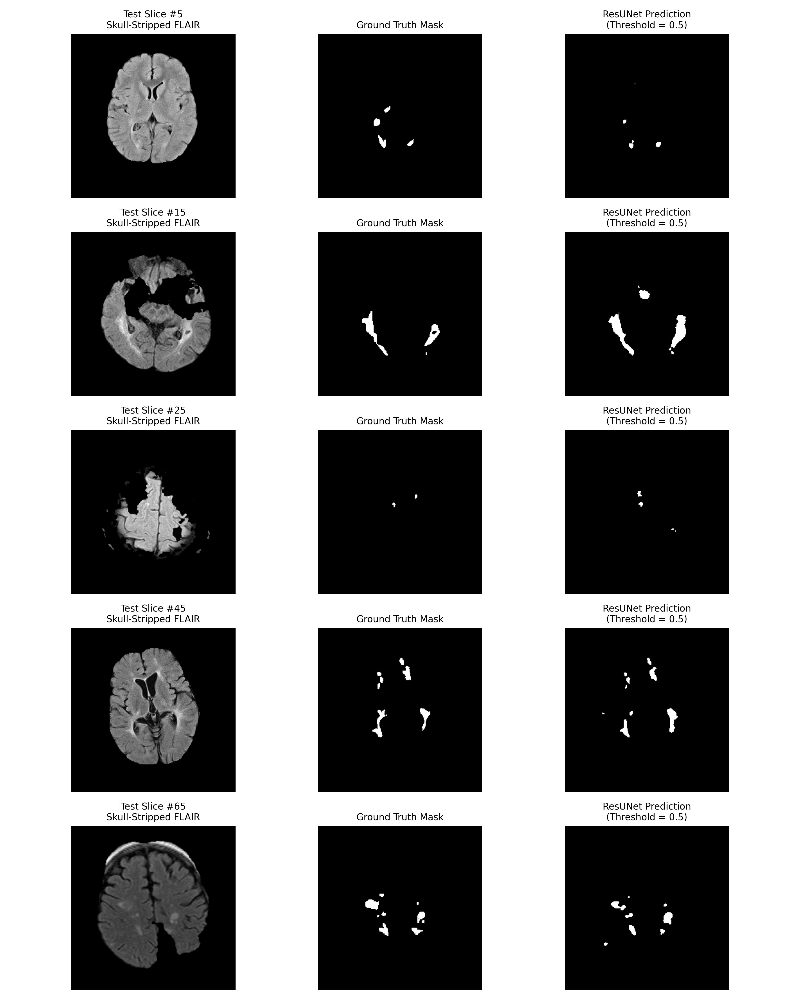

# Impact of Multi-Stage Preprocessing on 2D ResUNet-Based Explainable MS Lesion Segmentation in FLAIR Brain MRI

Undergraduate thesis project, Department of Computer Science, Islamia College University Peshawar, Pakistan (Session 2022-26).
Supervisor: Dr. Muhammad Sajjad. Research carried out at the Digital Image Processing (DIP) Lab.

**Keywords:** Multiple Sclerosis, brain MRI segmentation, ResUNet, quantile normalization, N4 bias-field correction, patient-level splitting, Grad-CAM, deep learning

> **Draft status:** every `[VERIFY]` marker below is a detail that must be checked against the original notebooks before this README is published. Search the file for `VERIFY` and remove each marker once it is confirmed.

---

## In Plain Words

Multiple Sclerosis (MS) damages the brain and shows up as bright spots called *lesions* on FLAIR MRI scans. Doctors track these lesions to follow the disease, but outlining them by hand is slow. Deep learning can outline them automatically, but results depend heavily on **how the scans are cleaned up before training**.

This project asks one question: **how much does the choice of preprocessing change the results of the same segmentation network?**
To answer it, the same 2D Residual U-Net (ResUNet) was trained on **five different preprocessing configurations** of the same 60-patient dataset and the results were compared. A **patient-level** split was used, so slices of one patient never appear in both training and evaluation.

## Key Results

Main comparison, on the **validation cohort (6 patients)**: `[VERIFY: slice count of the validation set]`

| Preprocessing | Dice | IoU | Precision | Recall | Loss |
|---|---|---|---|---|---|
| Stage 1 | 0.6244 | 0.4603 | 0.6408 | 0.6325 | 0.3888 |
| Stage 2 | 0.6095 | 0.4406 | 0.6627 | 0.5833 | 0.3982 |
| Stage 3 | 0.3381 | 0.2289 | 0.5374 | 0.3485 | 0.6619 |
| **Stage 4 (best)** | **0.6255** | **0.4623** | **0.6788** | 0.6051 | **0.3757** |
| Stage 5 | 0.6020 | 0.4355 | 0.6314 | 0.5972 | 0.4000 |

The Stage 1 row was confirmed from the training log (best epoch 35). `[VERIFY: Stages 2-5 against their training-history files]`

**Held-out test result (Stage 1 only, 6 patients, 85 slices):** Dice 0.5818, IoU 0.4179, precision 0.6346, recall 0.5611. This is lower than the validation Dice (0.6244), which shows that validation numbers are optimistic because the same cohort was used to pick the best epoch. `[VERIFY: add test results for Stages 2-5 if they exist]`

**What this shows**
- **Stage 4 scored highest** (Dice 0.6255), but only by a small margin: Stage 1 reached 0.6244, and Stages 2 and 5 are within about 0.024. With one training run per configuration, small differences should not be over-interpreted.
- **Stage 3 was clearly the weakest** (Dice 0.3381). Cropping without quantile normalization generalized poorly, while cropping *with* quantile normalization (Stage 4) gave the best result. The effect of a preprocessing step therefore depends on the steps it is combined with.
- **Precision was higher than recall in every configuration**, so the models tend to under-segment.
- **ResUNet vs. vanilla U-Net** (same Stage 5 preprocessing): Dice **0.6020 vs. 0.5421**. `[VERIFY: against the vanilla U-Net notebook]`

A Dice around 0.6 is moderate and in line with how difficult MS lesion segmentation is. **No state-of-the-art claim is made.**

<p align="center"></p>

## The Five Preprocessing Configurations

The five stages are **alternative configurations, not consecutive steps**. Each one starts from the raw FLAIR volume and has its own dataset and its own training run.

| Configuration | HD-BET skull stripping | N4 bias-field correction | qnorm | 2D crop |
|---|:-:|:-:|:-:|:-:|
| Stage 1 | ✓ | | | |
| Stage 2 | ✓ | ✓ | | |
| Stage 3 | ✓ | ✓ | | ✓ |
| Stage 4 | ✓ | ✓ | ✓ | ✓ |
| Stage 5 | ✓ | ✓ | ✓ | |

In all stages, slices are resized to 256 × 256 and min-max scaled to [0, 1] per slice.

- **HD-BET:** removes the skull and non-brain tissue (3D).
- **N4:** corrects smooth intensity differences caused by the MRI coil (3D).
- **qnorm (joint quantile normalization):** aligns the intensity distributions of the patient volumes so the same tissue has similar brightness across patients.
- **2D crop:** cuts away empty background around the brain.


## Dataset

- **Name:** Brain MRI Dataset of Multiple Sclerosis with Consensus Manual Lesion Segmentation and Patient Meta Information (Mendeley Data, Version 1)
- **Link:** https://data.mendeley.com/datasets/8bctsm8jz7/1 (DOI: 10.17632/8bctsm8jz7.1)
- **Associated paper:** A. M. Muslim et al., *Data in Brief*, vol. 42, 108139, 2022 (DOI: 10.1016/j.dib.2022.108139)
- **Used here:** FLAIR images and binary lesion masks of 60 MS patients (T1 and T2 scans were not used). The data was accessed through a Kaggle copy of the dataset. `[VERIFY: confirm the Kaggle copy is the unmodified Mendeley data]`
- **Slices:** only axial slices that contain lesions were kept.

### Patient-level split (seed 42)

Patients were split first (scikit-learn `train_test_split`, seed 42: 48 / 6 / 6), and slices were extracted afterwards, so slices from one patient never appear in more than one subset. The code checks that the three patient sets are disjoint. The same split was used for all configurations.

| Subset | Patients | Slices |
|---|---|---|
| Training | 48 (80%) | 628 |
| Validation | 6 (10%) | 74 |
| Test | 6 (10%) | 85 |

> **Slice counts are from the Stage 1 notebook (787 slices in total).** `[VERIFY: the thesis states 1,408 slices (1,117 / 146 / 145). Confirm which numbers are correct and use only one set.]`

## Model and Training

**2D ResUNet** (32,461,569 parameters): a U-Net whose convolution blocks are replaced by residual blocks. The encoder has four residual blocks (64, 128, 256, 512 filters), a 1024-filter bottleneck, and a decoder with transposed convolutions and long skip connections. Dropout (0.3 on the deepest skip features, 0.5 after the bottleneck) is used for regularization. A final 1×1 convolution with sigmoid gives the lesion probability map (threshold 0.5). The code is in [`src/resunet.py`](src/resunet.py).


Training settings in the **Stage 1 notebook** (the code behind the Stage 1 results):

| Setting | Value |
|---|---|
| Framework | TensorFlow / Keras 3 on Kaggle (2 × Tesla T4) |
| Input | 256 × 256 × 1 axial FLAIR slice |
| Loss | Soft Dice loss |
| Optimizer | Adam, learning rate 1e-4 |
| Batch size / epochs | 8 / 100 |
| Model selection | Best epoch by lowest validation loss (checkpointing) |
| Augmentation (training only) | Rotation up to 30°, shifts 10%, shear 10%, zoom 10%, horizontal flip; masks re-binarized after transformation |
| Metrics | Dice, IoU, precision, recall, computed per batch and averaged |

`[VERIFY: the thesis describes BCE + Dice loss, batch size 16, weight decay, ReduceLROnPlateau, a smaller augmentation set, and PyTorch. Confirm what the Stage 2-5 notebooks used and describe the real settings per stage.]`

## Explainability (Grad-CAM)

Grad-CAM heatmaps were computed for selected slices of two patients. In these examples, high activation lay mainly over bright periventricular and deep white-matter regions and followed the predicted masks, with little activation on normal-looking tissue and background. `[VERIFY: layer used for Grad-CAM, from the Grad-CAM notebook]`

This is a **qualitative check only**. It is not a clinical validation, a causal explanation, or a measure of accuracy.


## Limitations

1. **Validation-based reporting.** The main table comes from the validation cohort, which was also used to choose the best epoch, so these numbers are not unbiased. The Stage 1 test result (Dice 0.5818) is lower than its validation Dice (0.6244).
2. **Small cohort and single runs.** Validation and test sets have 6 patients each, and each configuration was trained once. Differences among Stages 1, 2, 4, and 5 are within epoch-to-epoch variation, and validation curves are noisy.
3. **Cause of the Stage 3 drop is unknown.** One possible explanation is inconsistent intensity scaling between patients after cropping, but this was not tested.
4. **qnorm reference.** It is not documented whether the quantile reference used only training patients. If not, validation and test volumes influenced the intensity mapping (without labels) in Stages 4 and 5.
5. **One modality, one dataset, 2D slices.** Only FLAIR from a single cohort was used, with no external validation, and 2D processing ignores continuity between slices.
6. **Lesion-containing slices only.** Slices without lesions were removed, so false positives on such slices are not reflected.
7. **Batch-level metrics.** Dice, IoU, precision, and recall are averaged over batches, not computed per patient or per lesion. Lesion-wise detection and patient-level volume agreement were not assessed.
8. **Research prototype.** This work is not intended for clinical use.

## Future Work

- Multiple seeds or patient-level k-fold cross-validation for confidence intervals
- A test-set evaluation for every configuration
- 3D models (3D ResUNet, nnU-Net) and multi-modal input (FLAIR + T1 + T2)
- Evaluation on multi-center data (for example ISBI 2015, MICCAI 2016)
- Lesion-wise metrics and lesion-free slices before any clinical consideration

## Repository Structure

```
.
├── README.md
├── requirements.txt
├── preprocessing/
│   ├── skull_strip.py          # step 1: HD-BET skull stripping
│   ├── n4_bias_correction.py   # step 2: N4 bias-field correction
│   └── n4_qc.py                # quality check for the N4 step
├── src/
│   ├── resunet.py              # 2D ResUNet (TensorFlow / Keras)
│   └── losses_metrics.py       # Dice loss, IoU, precision, recall
├── notebooks/                  # original Kaggle / Colab notebooks (outputs cleared)
└── assets/                     # figures used in this README
```

More scripts (slice extraction, training, evaluation, Grad-CAM) will be added as the notebooks are cleaned up. The full thesis is available on request.

## Acknowledgements

Thank you to my supervisor, Dr. Muhammad Sajjad, and to the senior members and colleagues of the Digital Image Processing (DIP) Lab, Islamia College University Peshawar, for their guidance. Thanks also to the authors of the public dataset and of the tools used: HD-BET, N4ITK, qnorm, SimpleITK, NiBabel, and TensorFlow.

## References

- A. M. Muslim et al., "Brain MRI dataset of multiple sclerosis with consensus manual lesion segmentation and patient meta information," *Data in Brief*, vol. 42, 108139, 2022. doi:10.1016/j.dib.2022.108139
- A. M. Muslim, Mendeley Data, Version 1, 2022. doi:10.17632/8bctsm8jz7.1
- F. Isensee et al., "Automated brain extraction of multisequence MRI using artificial neural networks," *Hum. Brain Mapp.*, 2019 (HD-BET).
- N. J. Tustison et al., "N4ITK: Improved N3 bias correction," *IEEE Trans. Med. Imag.*, 2010.
- B. M. Bolstad et al., "A comparison of normalization methods for high density oligonucleotide array data," *Bioinformatics*, 2003 (quantile normalization).
- O. Ronneberger, P. Fischer, T. Brox, "U-Net," *MICCAI*, 2015; K. He et al., "Deep residual learning for image recognition," *CVPR*, 2016; Z. Zhang et al., "Road extraction by deep residual U-Net," *IEEE GRSL*, 2018.
- R. R. Selvaraju et al., "Grad-CAM," *ICCV*, 2017.

## Contact

Muhammad Usman, muhammadusmandip@gmail.com, [GitHub](https://github.com/usmankhan876)
