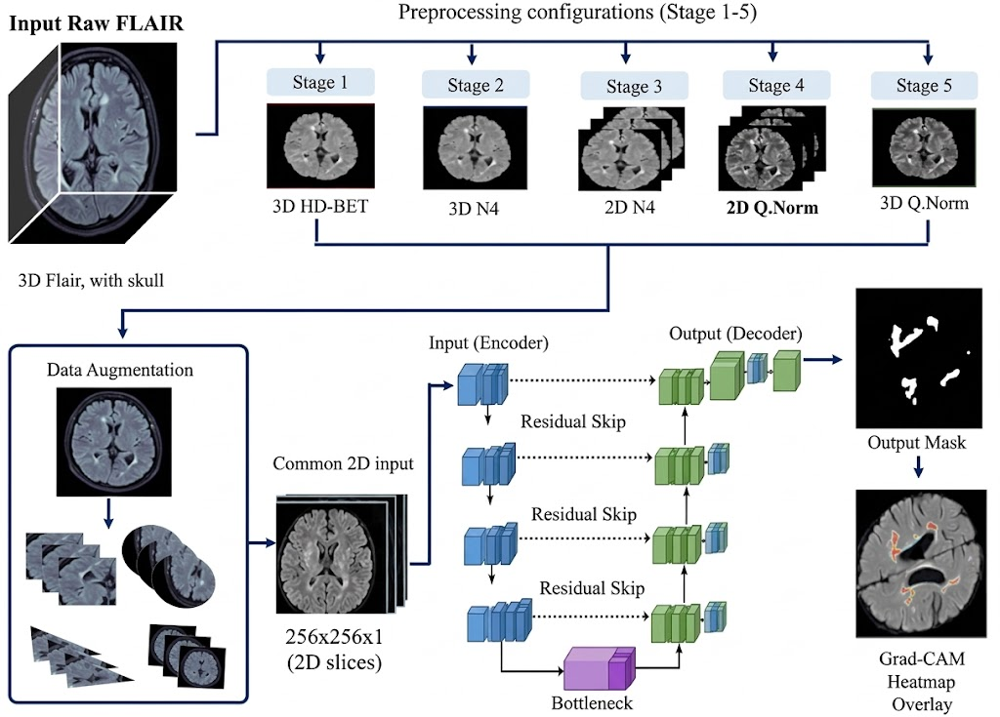
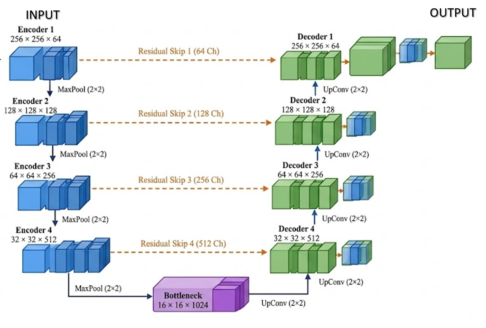
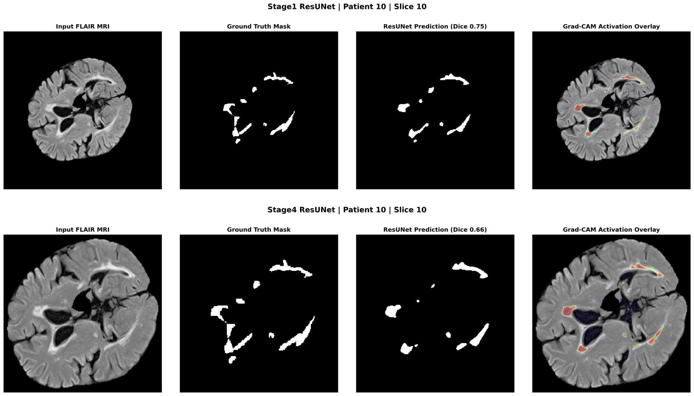

# Impact of Multi-Stage Preprocessing on 2D ResUNet-Based Explainable MS Lesion Segmentation in FLAIR Brain MRI

Undergraduate thesis project, Department of Computer Science, Islamia College University Peshawar, Pakistan (Session 2022-26).
Supervisor: Dr. Muhammad Sajjad. Research carried out at the Digital Image Processing (DIP) Lab.

**Keywords:** Multiple Sclerosis, brain MRI segmentation, ResUNet, quantile normalization, N4 bias-field correction, patient-level splitting, Grad-CAM, deep learning

> **Status:** numbers in this README were checked against the training notebooks and the training-history CSV files. Items that could not be checked are marked `[VERIFY: ...]`. Remove each marker once the question in it is answered.

---

## In Plain Words

Multiple Sclerosis (MS) damages the brain and shows up as bright spots called *lesions* on FLAIR MRI scans. Doctors track these lesions to follow the disease, but outlining them by hand is slow. Deep learning can outline them automatically, but results depend on **how the scans are prepared before training**.

This project asks one question: **how much does the choice of preprocessing change the results of the same segmentation network?**
To answer it, the same 2D Residual U-Net (ResUNet) architecture was trained on **five different preprocessing configurations** of the same 60-patient dataset, and the results were compared. The training settings are not identical across the five runs (see "Model and Training"), so differences between stages cannot be attributed to preprocessing alone.

For Stages 1, 2, and 5 the data were split **by patient** in the training code, so slices of one patient never appear in more than one subset. Stages 3 and 4 were trained on a separately prepared slice dataset whose patient assignment has not been verified. `[VERIFY: for the Split_80_10_10 dataset used by Stages 3 and 4, which patient IDs are in train / val / test, and are they the same as in Stages 1, 2, 5?]`

## Key Results

Each configuration was trained once. Values are for the checkpoint with the lowest validation loss. Validation and test cohorts each contain 6 patients. Stages 1, 2, and 5 have 74 validation and 85 test slices. Stages 3 and 4 have 118 validation and 120 test slices.

**Validation cohort** (used for checkpoint selection and learning-rate scheduling, so these values are optimistic):

| Preprocessing | Dice | IoU | Precision | Recall | Loss |
|---|---|---|---|---|---|
| Stage 1 | 0.6244 | 0.4603 | 0.6408 | **0.6325** | 0.3888 |
| Stage 2 | 0.6095 | 0.4406 | 0.6627 | 0.5833 | 0.3982 |
| Stage 3 | 0.3381 | 0.2289 | 0.5374 | 0.3485 | 0.6619 |
| Stage 4 | **0.6255** | **0.4623** | **0.6788** | 0.6051 | **0.3757** |
| Stage 5 | 0.6020 | 0.4355 | 0.6314 | 0.5972 | 0.4000 |

**Held-out test cohort** (same checkpoints, evaluated once in each notebook):

| Preprocessing | Dice | IoU | Precision | Recall | Loss |
|---|---|---|---|---|---|
| Stage 1 | **0.5818** | **0.4179** | 0.6346 | 0.5611 | **0.4197** |
| Stage 2 | 0.5743 | 0.4116 | **0.6688** | 0.5263 | 0.4273 |
| Stage 3 | 0.4486 | 0.3214 | 0.5802 | 0.5416 | 0.5514 |
| Stage 4 | 0.4618 | 0.3322 | 0.5959 | 0.3972 | 0.5382 |
| Stage 5 | 0.5431 | 0.3879 | 0.5707 | **0.5814** | 0.4606 |

Stage 3 precision and recall were computed on probabilities, not on thresholded masks, so they are not directly comparable with the other rows (see "Metrics").

**What this shows**
- **On validation, Stage 4 scored highest** (Dice 0.6255), but only by a small margin: Stage 1 reached 0.6244, and Stages 2 and 5 are within 0.024.
- **On the test cohort the ranking changes.** Stage 1 is best (0.5818), followed by Stage 2 (0.5743) and Stage 5 (0.5431). Stage 4 (0.4618) and Stage 3 (0.4486) are lowest. Stage 4's Dice fell by 0.1637 from validation to test; Stages 1, 2, and 5 fell by 0.0352 to 0.0589.
- **Stage 3 was the weakest on validation** (Dice 0.3381; its validation Dice never reached 0.50 in 100 epochs). Its test Dice (0.4486) is higher than its validation Dice.
- **The cause of the weaker cropped results is not known.** Stages 3 and 4 differ from Stages 1, 2, and 5 in more than cropping: they use a different slice set (1,186 vs. 787 slices), milder augmentation, and Stage 3 used different metric settings. The effect of cropping or of qnorm therefore cannot be isolated from these data.
- **Precision was higher than recall in every configuration on the validation cohort.** On the test cohort this holds for Stages 1, 2, 3, and 4, but not for Stage 5 (precision 0.5707, recall 0.5814).
- **ResUNet vs. vanilla U-Net** (same Stage 5 preprocessing, validation cohort): Dice 0.6020 vs. 0.5421, as reported in the thesis. `[VERIFY: the vanilla U-Net notebook was not available for this check. Please confirm 0.5421 (IoU 0.3812, precision 0.5890, recall 0.5214, loss 0.4580) from that notebook or its history file.]`

A Dice around 0.6 on validation and 0.58 or lower on test is moderate. **No state-of-the-art claim is made.**

<p align="center"></p>

The figure shows Stage 1 predictions on test slices 5, 15, 25, 45, and 65.

## The Five Preprocessing Configurations

The five stages are **alternative configurations, not consecutive steps**. Each one starts from the raw FLAIR volume and has its own dataset and its own training run.

| Configuration | HD-BET skull stripping | N4 bias-field correction | qnorm | 2D crop |
|---|:-:|:-:|:-:|:-:|
| Stage 1 | ✓ | | | |
| Stage 2 | ✓ | ✓ | | |
| Stage 3 | ✓ | ✓ | | ✓ |
| Stage 4 | ✓ | ✓ | ✓ | ✓ |
| Stage 5 | ✓ | ✓ | ✓ | |

This table follows the thesis (Table 3.3). The training notebooks do not run HD-BET, N4, qnorm, or the cropping step; they load already processed files. `[VERIFY: the preprocessing notebooks/scripts (HD-BET, N4, qnorm, cropping) were not available for this check. Do they match this table? In particular, the Stage 3 notebook's own description says "Bounding-Box Cropped + Quantile Normalized". Was qnorm applied to the Stage 3 images, yes or no?]`

How each stage enters the training notebook:

| Stage | Input to the training notebook | Slice creation |
|---|---|---|
| 1 | 60 skull-stripped 3D FLAIR volumes | In the notebook, after the patient split |
| 2 | 60 N4-corrected, skull-stripped 3D volumes | In the notebook, after the patient split |
| 3 | Pre-cropped 2D slices stored as 8-bit PNG, folder `Split_80_10_10` | Prepared outside the notebook |
| 4 | Pre-cropped, quantile-normalized 2D slices stored as 8-bit PNG, folder `Split_80_10_10` | Prepared outside the notebook |
| 5 | 60 quantile-normalized 3D volumes (uncropped) | In the notebook, after the patient split |

- **Stages 1, 2, 5 (in the notebook):** slices without lesion pixels are dropped; each remaining slice is resized to 256 × 256 (bilinear for images, nearest-neighbor for masks); masks are binarized (lesion = value above 0); each image slice is min-max scaled to [0, 1].
- **Stages 3, 4 (in the notebook):** PNG images are divided by 255 to give [0, 1] values; masks are thresholded to {0, 1}. `[VERIFY: in the separate cropping script, were slices without lesions removed, and were they min-max scaled before being saved as PNG?]`
- **HD-BET:** removes the skull and non-brain tissue (3D).
- **N4:** corrects smooth intensity differences caused by the MRI coil (3D).
- **qnorm (joint quantile normalization):** aligns the intensity distributions of the patient volumes.
- **2D crop:** cuts away empty background around the brain.



## Dataset

- **Name:** Brain MRI Dataset of Multiple Sclerosis with Consensus Manual Lesion Segmentation and Patient Meta Information (Mendeley Data, Version 1)
- **Link:** https://data.mendeley.com/datasets/8bctsm8jz7/1 (DOI: 10.17632/8bctsm8jz7.1)
- **Associated paper:** A. M. Muslim et al., *Data in Brief*, vol. 42, 108139, 2022 (DOI: 10.1016/j.dib.2022.108139)
- **Used here:** FLAIR images and binary lesion masks of 60 patients (the notebooks load only the FLAIR and lesion-mask files; each notebook asserts that 60 patient pairs are found). The notebooks read the data from Kaggle datasets uploaded under the author's account. `[VERIFY: are the Kaggle copies identical to the unmodified Mendeley files (apart from the HD-BET / N4 / qnorm / crop outputs)?]`

### Patient-level split (Stages 1, 2, 5)

Patients are split first (scikit-learn `train_test_split`, `random_state=42`, 12 patients held out and then divided 6 / 6), and slices are extracted afterwards. The Stage 1 notebook asserts that the three patient sets are disjoint; Stages 2 and 5 use the same split code on the same sorted list of 60 patient IDs and produce the same slice counts.

| Subset | Patients | Slices (Stages 1, 2, 5) | Slices (Stages 3, 4) |
|---|---|---|---|
| Training | 48 (80%) | 628 | 948 |
| Validation | 6 (10%) | 74 | 118 |
| Test | 6 (10%) | 85 | 120 |
| Total | 60 | 787 | 1,186 |

Stages 3 and 4 load a pre-partitioned folder (`Split_80_10_10`) with 1,186 lesion slices. The split of that folder is not produced by the notebooks, so its patient assignment is not verified (see the marker above).

## Model and Training

**2D ResUNet** (32,461,569 parameters: 32,443,905 trainable and 17,664 non-trainable batch-normalization statistics). The architecture code is identical in all five notebooks. The encoder has four residual blocks (64, 128, 256, 512 filters), followed by a 1024-filter bottleneck and a decoder with transposed convolutions and long skip connections. Each residual block has two 3 × 3 convolutions with batch normalization and a 1 × 1 projection shortcut. Dropout 0.3 is applied to the output of the fourth encoder block (which feeds both the bottleneck and the deepest skip connection), and dropout 0.5 after the bottleneck. A final 1 × 1 convolution with sigmoid gives the lesion probability map (threshold 0.5).



**Settings that are the same in all stages:** TensorFlow / Keras (Python 3.12, Kaggle notebooks, NVIDIA Tesla T4 according to the notebook metadata; the `.keras` checkpoint format and Keras 3 log format indicate Keras 3, but the exact TensorFlow/Keras version numbers are not printed in the notebooks), input 256 × 256 × 1, soft Dice loss as the only loss, Adam with initial learning rate 1e-4 and no weight decay, batch size 8, 100 epochs, no early stopping, seed 42, checkpoint with the lowest validation loss (`save_best_only`).

**Settings that differ between stages:**

| Setting | Stage 1 | Stage 2 | Stage 3 | Stage 4 | Stage 5 |
|---|---|---|---|---|---|
| Learning-rate schedule | constant | ReduceLROnPlateau (val loss, factor 0.5, patience 5, min 1e-6) | same as Stage 2 | same as Stage 2 | same as Stage 2 |
| Augmentation: rotation | ±30° | ±20° | ±15° | ±15° | ±20° |
| Augmentation: shifts | 10% | 10% | 5% | 5% | 10% |
| Augmentation: shear / zoom | 10% / 10% | 10% / 10% | none | none | 10% / 10% |
| Augmentation: horizontal flip | yes | yes | yes | yes | yes |
| Masks re-binarized after augmentation | yes | yes | no | yes | yes |
| Dice / IoU smoothing constant | 1 | 1 | 1e-6 | 1 | 1 |
| Precision / recall | on masks thresholded at 0.5 | same as Stage 1 | on probabilities (no threshold) | same as Stage 1 | same as Stage 1 |

Augmentation is applied to the training set only, with the same random seed for each image and its mask. No brightness or contrast augmentation is used. Newly exposed pixels are filled with the nearest value.

**Training behavior** (from the history CSV files):

| | Stage 1 | Stage 2 | Stage 3 | Stage 4 | Stage 5 |
|---|---|---|---|---|---|
| Best epoch (lowest val. loss) | 35 | 30 | 47 | 98 | 60 |
| Training Dice, epoch 100 | 0.666 | 0.659 | 0.606 | 0.621 | 0.634 |
| Validation Dice, last 10 epochs (mean ± SD) | 0.494 ± 0.100 | 0.526 ± 0.030 | 0.306 ± 0.019 | 0.547 ± 0.036 | 0.540 ± 0.022 |
| First epoch with validation Dice ≥ 0.50 | 11 | 10 | not reached | 8 | 9 |
| First epoch logged at reduced learning rate / epoch at which 1e-6 is first logged | none | 29 / 61 | 15 / 45 | 14 / 51 | 15 / 48 |

SD is the sample standard deviation (n − 1) over the last 10 epochs. The best epoch is also the epoch of the highest validation Dice in all five stages. Stage 4's checkpoint was chosen at epoch 98, after the learning rate had reached its minimum at epoch 51.

**Metrics.** Loss, Dice, IoU, precision, and recall are computed over all pixels of each mini-batch (the slices of a batch are pooled) and then averaged over batches. They are not computed per slice, per patient, or per lesion. Dice and IoU use the predicted probabilities, not thresholded masks.

## Explainability (Grad-CAM)

Grad-CAM was used as a qualitative check on selected slices. This is **not** a clinical validation, a causal explanation, or a measure of accuracy.

`[VERIFY: the Grad-CAM notebook was not available for this check. Which layer was used (the thesis says the final decoder layer), which patients and slices (the thesis names Patient 10 and Patient 46), and which stages? The statement that activation lay mainly over hyperintense periventricular and deep white-matter regions comes from the thesis and was not checked against the notebook.]`



## Limitations

1. **Validation-based selection.** The validation cohort was used to choose the best epoch and to schedule the learning rate, so validation numbers are optimistic. On the test cohort the Dice is lower than on validation for Stages 1, 2, 4, and 5 (for example, Stage 1: 0.6244 vs. 0.5818; Stage 4: 0.6255 vs. 0.4618). Stage 3 is the exception (0.3381 validation, 0.4486 test).
2. **Small cohorts and single runs.** Validation and test sets have 6 patients each, and each configuration was trained once. On validation, Stages 1, 2, 4, and 5 span a Dice range of 0.0235, while the last-ten-epoch validation Dice varies with an SD of 0.022 to 0.100. The validation ranking among these four should not be over-interpreted.
3. **Stages are not trained under identical conditions.** Augmentation settings differ, Stage 1 used no learning-rate scheduler, and Stage 3 used different metric settings and no mask re-binarization after augmentation. Differences between stages cannot be attributed to preprocessing alone.
4. **Different slice set and unverified split for Stages 3 and 4.** They use 1,186 slices from a separately prepared dataset instead of 787, and their patient assignment was not verified.
5. **Cause of the Stage 3 and Stage 4 results is unknown.** One possible explanation (slice-wise min-max scaling after cropping depends on tissue proportion) was not tested.
6. **qnorm reference.** The notebooks load already normalized files. `[VERIFY: was the quantile reference computed from all 60 patients or from the training patients only? Where is that code?]` If it used all 60, validation and test volumes influenced the intensity mapping (without labels) in Stages 4 and 5.
7. **One modality, one dataset, 2D slices.** Only FLAIR from a single cohort was used, with no external validation, and 2D processing ignores continuity between slices.
8. **Lesion-containing slices only.** Slices without lesions were removed (verified for Stages 1, 2, 5), so false positives on such slices are not reflected.
9. **Batch-level soft metrics.** Dice and IoU are averaged over batches and computed on probabilities. Lesion-wise detection and patient-level volume agreement were not assessed.
10. **Research prototype.** This work is not intended for clinical use.

## Future Work

- Multiple seeds or patient-level k-fold cross-validation for confidence intervals
- Retraining all stages under identical augmentation, scheduling, and slice sets
- 3D models (3D ResUNet, nnU-Net) and multi-modal input (FLAIR + T1 + T2)
- Evaluation on multi-center data (for example ISBI 2015, MICCAI 2016)
- Lesion-wise metrics and lesion-free slices before any clinical consideration

## Repository Structure

`[VERIFY: this README lists files that were not in the material checked (preprocessing scripts, src/, assets/). Confirm each listed file exists in the repository before publishing, or remove the lines.]`

```
.
├── README.md
├── requirements.txt
├── preprocessing/
│   ├── skull_strip.py          # HD-BET skull stripping
│   ├── n4_bias_correction.py   # N4 bias-field correction
│   └── n4_qc.py                # quality check for the N4 step
├── src/
│   ├── resunet.py              # 2D ResUNet (TensorFlow / Keras)
│   └── losses_metrics.py       # Dice loss, IoU, precision, recall
├── notebooks/                  # original Kaggle / Colab notebooks (outputs cleared)
└── assets/                     # figures used in this README
```

More scripts (slice extraction, training, evaluation, Grad-CAM) will be added as the notebooks are cleaned up. The full thesis is available on request.

## Acknowledgements

Thank you to my supervisor, Dr. Muhammad Sajjad, and to the senior members and colleagues of the Digital Image Processing (DIP) Lab, Islamia College University Peshawar, for their guidance. Thanks also to the authors of the public dataset and of the tools used: HD-BET, N4ITK, qnorm, SimpleITK, NiBabel, and TensorFlow.

## References

- A. M. Muslim et al., "Brain MRI dataset of multiple sclerosis with consensus manual lesion segmentation and patient meta information," *Data in Brief*, vol. 42, 108139, 2022. doi:10.1016/j.dib.2022.108139
- A. M. Muslim, Mendeley Data, Version 1, 2022. doi:10.17632/8bctsm8jz7.1
- F. Isensee et al., "Automated brain extraction of multisequence MRI using artificial neural networks," *Hum. Brain Mapp.*, 2019 (HD-BET).
- N. J. Tustison et al., "N4ITK: Improved N3 bias correction," *IEEE Trans. Med. Imag.*, 2010.
- B. M. Bolstad et al., "A comparison of normalization methods for high density oligonucleotide array data," *Bioinformatics*, 2003 (quantile normalization).
- O. Ronneberger, P. Fischer, T. Brox, "U-Net," *MICCAI*, 2015; K. He et al., "Deep residual learning for image recognition," *CVPR*, 2016; Z. Zhang et al., "Road extraction by deep residual U-Net," *IEEE GRSL*, 2018.
- R. R. Selvaraju et al., "Grad-CAM," *ICCV*, 2017.

## Contact

Muhammad Usman, muhammadusmandip@gmail.com, [GitHub](https://github.com/usmankhan876)
